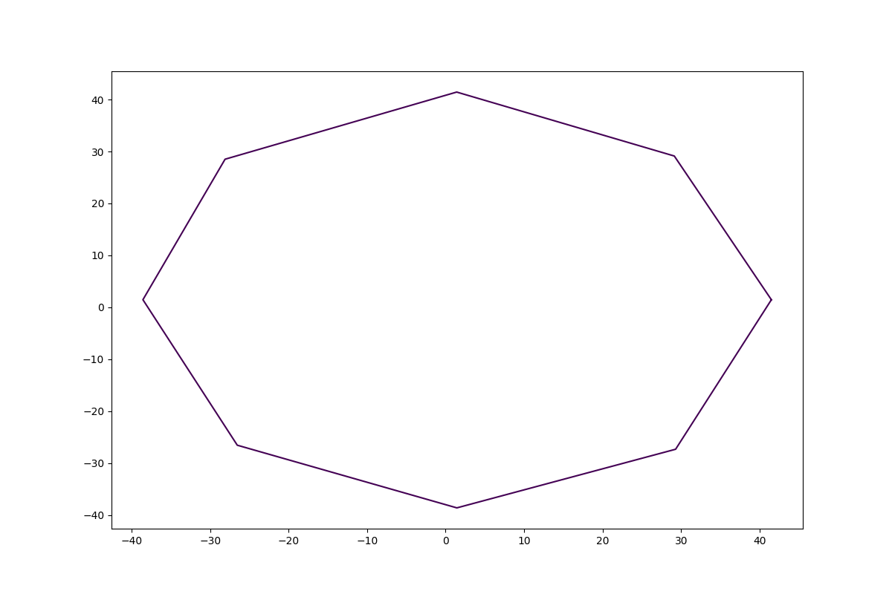
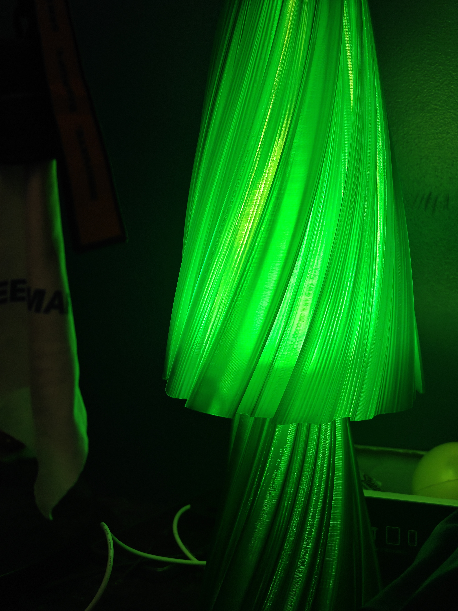

# Differential growth

This project implements the differential growth algorithm, specifically to use in the generation of lampshades and vases. 

Particles repel nearby particles, attract their immediate neighbours, and move over time; new particles are inserted when adjacent points become too far apart. 'sensitive dependence on intitial conditions' means small changes in initial conditions cause widely variant results.

<p align="center">
    
</p>

<p align="center"><em>An example of a 2D differential growth simulation.</em></p>

The same 2D growth can be used to make 3D vase and lampshade surfaces in two ways: record the evolving outline at successive heights, or repeat and transform one outline into a stack of layers. \*\*This is **layered 2D / 2.5D growth**, not a volumetric 3D growth simulation.

*apologies in advance, this repo isn't meant to be used by other people, it was just what i wrote for my lampshade generation project. Nowadays you could easily oneshot this with AI and get something much more usable*

<p align="center">
    
</p>

<p align="center"><em>A lampshade created using this project.</em></p>

## Project structure

- `particle.py` — particles, forces, initial perturbations and the'clump' (the thing that grows). All the stuff for the 2d sim
- `sim.py` — the `growth_sim` wrapper: growth, plotting, smoothing, layer transforms, persistence and meshing. All the stuff for the 3d sim and helpers for running sims
- `examples/` — scripts for simulations, saved-layer processing and specific designs.
- `saves/` — example `layers.pkl` files and previews, as well as a default location for new runs.
- `stls/` — example exported meshes and a convenient output directory.

## Setup

Use Python 3.11 or 3.12. From the repository root on Linux:

```bash
python3 -m venv .venv
source .venv/bin/activate
python -m pip install -r requirements.txt
```

## Run the sample scripts

The examples use paths relative to their **working directory**, not the script file. When run from `examples/`, drawing writes to `examples/saves/`, which is separate from the `saves/` directory included in the repository. Create it once, then run the scripts:

```bash
cd examples
mkdir -p saves
python writeup.py                   # grow and display a 2D clump
python basic_clump.py               # display the last layer of a saved clump
python grow_vase.py                 # grow and record a layered vase
```

Other scripts worth exploring:

| Script | Workflow |
| --- | --- |
| `normalise_vase.py` | Normalizes a saved outline, smooths it, and creates a modulated vase. Switch the `if True` / `if False` blocks to try straight, tapered, varying-width, rotated or custom-taper versions. |
| `normallooking.py` | Generates a lamp shade; an alternate disabled block generates a lamp base. |
| `short-fat-dense.py` | Loads an off-centre outline, inserts extra points, smooths it and creates a short form. |
| `wide_vase.py` | Smooths and trims an existing layered vase before meshing. **Edit its hard-coded absolute input path** to point to a local `layers.pkl` first. |
| `test.py` | Standalone Matplotlib slider experiment, not a growth simulation. `basic_vase.py` and `smooth_vase.py` are currently empty. |


## Create your own 2D growth

```python
import random

import particle
import sim


def main():
    random.seed(42)  # Optional: repeat the initial perturbations and growth zones.
    clump = particle.clump(
        size=12,
        radius=40,
        insertDistance=15,
        _force=particle.force(rDistance=75, k=40, clamp=1e99),
        _perturbation=particle.perturbation(prob=0.5, magnitude=2),
        particleKwargs={"mass": 1, "friction": 0.5, "life": 100},
    )

    simulation = sim.growth_sim(
        clump,
        threeD=False,
        saveToFile=True,
        growingKwargs={
            "growthZoneIterations": 30,
            "coverage": 0.3,
            "life": 50,
            "growth": 1,
        },
    )
    simulation.grow_clump(iterations=50, animate=False)
    simulation.draw_clump(showParticles=True, colour="olive")
    simulation.show()


if __name__ == "__main__":
    main()
```

`grow_clump` updates the current `simulation.clump`. With `animate=True`, it draws every iteration; `showProgress=True` retains earlier outlines rather than clearing them. With `saveToFile=True`, it also stores the final clump as a single layer and writes a timestamped `saves/<timestamp>/layers.pkl` and `preview.png`. The automatic preview is saved before the final explicit `draw_clump` above; enable animation if you want the growth drawn during that save.

For lower-level use without the plotting wrapper, call `clump.run_sim(iterations)` or `clump.run_sim_iteration()`; these do not schedule growth zones or save layers. You can also replace `clump.particles` with an ordered, nonempty loop of `particle.particle([x, y, z], **kwargs)` objects before growing; keep `clump.particleKwargs` consistent with the attributes intended for newly inserted particles.

### Growth parameters

- `size` and `radius` set the initial circular loop. `insertDistance` is the maximum spacing before midpoint insertion; use a positive value. A smaller value generally produces more particles and greater computational cost.
- `particle.perturbation(prob, magnitude)` randomly offsets initial points, breaking symmetry. The built-in perturbation moves selected points in positive X and Y, not in random directions.
- `particle.force(rDistance, k, clamp)` controls the repulsion range, force strength and maximum force. The implementation uses inverse-square forces. Although the constructor also accepts `aDistance` and `neighbors`, the current update code attracts only immediate neighbours and does not use `aDistance` as its attraction threshold.
- `mass`, `friction`, `life` and `growthRate` in `particleKwargs` affect movement. `friction` is the fraction of velocity retained after a move. New particles use the clump's `particleKwargs`.
- `growingKwargs` schedules growth zones: every `growthZoneIterations`, a randomly selected contiguous fraction (`coverage`, from 0 to 1) receives `life` additional active iterations. The `growth` value is currently unused. Pass at least `{}` when calling the wrapper's growth methods: its default `None` cannot be unpacked.

#### Particle life and growth zones

`life` is the number of remaining iterations in which a particle can move. Each active particle moves according to its velocity and `growthRate`, then loses one unit of life. Once its life reaches zero, it stops moving and its velocity is reset. It is **not removed** from the clump: it remains part of the outline and can still exert forces on other particles.

`particleKwargs["life"]` sets the starting life of the initial particles **and of each new particle** inserted as the outline grows. For example, `life=100` lets a newly created particle move for up to 100 updates, unless a growth zone extends its life. A shorter life can leave parts of the outline stationary while newer particles continue moving; a very large life keeps particles active for most or all of a run.

The separate `growingKwargs["life"]` is the amount **added** to the remaining life of particles in a growth zone, not their starting life. For the 2D example above, after every 30 iterations a random contiguous 30% of the particles receives 50 extra life. This extends active particles' remaining movement time and can reactivate particles whose life has reached zero; they can move again on a subsequent iteration. Growth zones therefore allow selected sections of the outline to keep growing or resume growth while other sections remain stationary.

## Create a 3D surface from evolving growth

```python
import particle
import sim


def main():
    clump = particle.clump(
        size=12,
        radius=40,
        insertDistance=15,
        _force=particle.force(rDistance=75, k=40),
        _perturbation=particle.perturbation(prob=0.5, magnitude=2),
        particleKwargs={"mass": 1, "friction": 0.5, "life": 100},
    )
    simulation = sim.growth_sim(
        clump, threeD=True, saveToFile=True, growingKwargs={}
    )
    simulation.grow_vase(iterations=30, layers=30, draw=False)
    simulation.draw_vase()
    simulation.convert_layers_to_mesh(showPlotly=False)
    simulation.export_mesh_stl("stls/my-grown-vase")
    simulation.show()


if __name__ == "__main__":
    main()
```

`threeD=True` selects a 3D plot; it does not change the underlying growth into a 3D particle simulation. `saveToFile=True` is important here: `grow_vase` only retains the recorded layers when it is enabled, and automatically saves them to a timestamped directory. With `draw=False`, the automatic preview is saved before `draw_vase` and may be blank; save the figure again after drawing if a populated preview is needed. `layers` controls the sampling interval rather than guaranteeing an exact count: sampling starts only when the iteration index is greater than `startingIt` (default 0). Each recorded layer is one Z unit above the previous one. Record at least two layers before meshing.

## Make a 3D form from a saved outline

This workflow can use any compatible `layers.pkl`, including the final layer saved by the 2D example or one of the files shipped in `saves/`. Run the following as a script in the repository root:

```python
import particle
import sim


def main():
    simulation = sim.growth_sim(particle.clump(), threeD=True, growingKwargs={})
    simulation.load_clump_from_layers("saves/med-dense/layers.pkl", layer="last")

    # Smooth the selected outline, then use it as the source for every layer.
    simulation.run_clump_smoothing(
        2, simulation.gaussian_smooth, smoothingKwargs={"points": 5}
    )
    simulation.modulated_vase(
        layers=100,
        layer=len(simulation.layers) - 1,
        rBounds=(60, 160, 10),
        period=2,
        zInc=5,
        taper=0.0,
        rotation=100,
        showProgress=True,
    )
    simulation.convert_layers_to_mesh(showPlotly=False)
    simulation.export_mesh_stl("stls/my-shade")
    simulation.show()


if __name__ == "__main__":
    main()
```

`modulated_vase` replaces the existing layer list with transformed copies of the chosen layer. `rBounds` gives the minimum radius, maximum radius and sinusoidal width variation; `period` sets the number of width cycles, `zInc` is the height step, and `rotation` is the approximate total twist in degrees across the stack. `taper` can be a float specifying the radial reduction per layer, or a callable taking the layer index and returning the reduction. Use `0.0`, not integer `0`: the current implementation only handles floats or callables. Radius normalization requires an outline with varying radii; a perfectly circular outline has a zero radial range.

For a simple unmodulated stack instead, call `simulation.draw_vase_from_layer(layers=100, layer=-1)` after loading. It replaces the layers with copies at successive integer Z heights and draws them.

## Process, save and export

- **Load:** `simulation.load_clump_from_layers(path, layer="last")` loads all layers and selects one as the current clump; an integer selects a specific layer. Prefer this explicit method over passing a path to the constructor, which resets the loaded layer list during initialization. Pickle files can execute code when loaded: only load trusted files.
- **Smooth:** `run_clump_smoothing(iterations, simulation.moving_average_smooth, smoothingKwargs={"points": 5})` smooths the selected clump. Use `run_vase_smoothing(iterations, simulation.gaussian_smooth, smoothingKwargs={"points": 5})` for every layer, or `smooth_vase` for one pass. Gaussian weights are not normalized and can also change Z coordinates. The current vase-smoothing display interval has a precedence bug, so do not rely on `displayIts` for regular previews.
- **Normalize or rotate:** call `convert_to_polar()`, then `normalise_to_circle(min=..., max=...)` and/or `rotate_layer(radians=...)`, then `polar_update_clump()` to write the transformed XY coordinates back. `convert_to_cartesian()` returns coordinates without updating the clump.
- **Trim:** `trim_vase(n)` removes the first `n` layers, not the last `n`.
- **Save modified layers:** `simulation.save_clump(path="saves/my-new-run/")` writes `layers.pkl` and `preview.png`. The directory must not already exist and the path must end in `/`. Without a path it creates `./saves/<timestamp>/`; names can collide if saved within the same second. It serializes `simulation.layers`, not just the current clump; the `filename` argument is currently ignored.
- **Mesh and export:** call `convert_layers_to_mesh(showPlotly=True)` for an optional browser preview, then `export_mesh_stl("stls/name")`; `.stl` is appended automatically. The converter assumes the final layer has at least as many vertices as every earlier layer. It joins corresponding vertices after inserting points into shorter layers. The result is an open, zero-thickness side surface; `meshTopBottom` is currently unused. Inspect and repair/thicken/cap the mesh in external software before treating it as printable.

Each growth iteration creates a multiprocessing pool, so dense or long simulations can be slow. Start with small iteration counts and increase them after checking the outline. Custom force objects used during growth need to be pickleable by multiprocessing.
